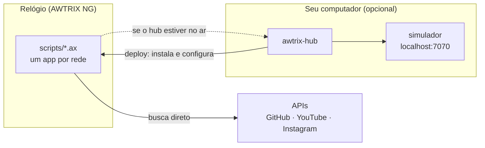

<div align="center">

# project.awtrix

**Seus números das redes sociais num relógio de LEDs na mesa.**


Seguidores do **GitHub**, **YouTube**, **Instagram** e **LinkedIn** num Ulanzi TC001, com variação do dia, barra até a próxima meta e festa quando a meta é batida.<br>
O relógio busca tudo **sozinho, pelo Wi-Fi**: não precisa de computador ligado.

</div>

---

## O que aparece no relógio

| | |
|---|---|
|  | **Contador**: ícone, número compacto (`12.3K`, `1.2M`) e a barra azul até a próxima meta. Aqui, 794 seguidores do GitHub, quase em 800. |
|  | **Variação do dia**: quanto subiu (verde) ou caiu (vermelho) desde a meia-noite. Quando não cabe ao lado do número, o texto rola. |
|  | **Meta batida**: uma notificação em arco-íris com som, uma vez por meta. |
|  | **A hora** continua na rotação, como em qualquer relógio. |

Também dá para acompanhar o **Vasco ao vivo** (placar, gol, intervalo e fim) pelo [hub](#o-hub-opcional).

## Como funciona



- O relógio roda o firmware livre **[AWTRIX NG](https://blueforcer.github.io/awtrix-ng/)**, que executa pequenos programas (scripts em [Berry](https://berry-lang.github.io/)) dentro do aparelho. Cada rede social é um script em [`scripts/`](scripts).
- Os scripts buscam os números, guardam a variação do dia e as metas **no próprio relógio** e sobrevivem a quedas de energia.
- O **`awtrix-hub`** é um programa de linha de comando que instala os scripts no relógio a partir de um arquivo de configuração. Ele também tem um simulador no navegador e, se você quiser, pode ficar rodando como fonte de dados extra.

## Do que você precisa

- Um **Ulanzi TC001**, o relógio de pixels da Ulanzi ([onde comprar](https://blueforcer.github.io/awtrix-ng/getting-started/buy/)). Outros relógios com AWTRIX NG devem funcionar, mas não foram testados.
- Um **cabo USB-C de dados**, só para a instalação do firmware. Cabo só de carga não serve.
- **Chrome ou Edge** no computador (o Safari não grava firmware).
- **[Go](https://go.dev/dl/) 1.27+** para compilar o `awtrix-hub`.
- As chaves das redes que quiser mostrar ([veja como pegar cada uma](#chaves-das-redes)). O GitHub funciona sem nenhuma.

## Começando

### 1. Instale o AWTRIX NG no relógio

> Isso substitui o firmware de fábrica da Ulanzi e apaga as configurações dele. Se quiser poder voltar, [faça um backup antes](https://blueforcer.github.io/awtrix-ng/esp32/getting-started/flashing/#back-up-the-original-firmware).

1. Ligue o relógio no computador pelo cabo USB-C.
2. Abra o [flasher do AWTRIX NG](https://blueforcer.github.io/awtrix-ng/esp32/getting-started/flashing/) no Chrome, clique em **Fresh install** e escolha a porta `usbserial`.
3. Espere aparecer *Done*. O cabo não é mais necessário: o resto é pelo Wi-Fi.

<details>
<summary>A porta não aparece ou a gravação falha?</summary>

- Quase sempre é o cabo: teste outro, ligado direto no computador (sem hub USB). `ls /dev/cu.*` deve mostrar um `usbserial`.
- Dá para gravar pelo terminal com o [esptool](https://docs.espressif.com/projects/esptool/): baixe `usb-awtrix-ng.zip` nos [releases](https://github.com/Blueforcer/awtrix-ng/releases), descubra o tamanho da flash com `esptool --port <porta> flash-id` e grave a imagem desse tamanho com `esptool --port <porta> --baud 115200 write-flash 0x0 usb-awtrix-ng-<tamanho>.bin`. Velocidades maiores podem falhar no TC001. Alguns TC001 têm 16 MB, não os 4 MB comuns.

</details>

### 2. Conecte ao Wi-Fi

1. No celular, entre na rede **`awtrixng-xxxxxx`** que o relógio cria. A página de configuração abre sozinha (ou acesse `http://192.168.4.1`).
2. Escolha o Wi-Fi de casa. O relógio reinicia e mostra o **IP** no display.
3. Abra `http://<ip>` no navegador e ajuste:
   - **fuso horário** e servidor de hora (no Brasil: `<-03>3` e `br.pool.ntp.org`);
   - **Apps**: desligue os nativos que não quiser (aqui ficou só a hora);
   - **brilho**.

### 3. Configure o projeto

```sh
git clone https://github.com/marcopollivier/project.awtrix.git
cd project.awtrix
cp config.example.yaml config.yaml
cp .env.example .env
make build
```

Em `config.yaml`, coloque o IP do relógio e os **seus** perfis:

```yaml
device:
  url: http://192.168.0.50        # o IP que apareceu no display

sources:
  github:
    user: seu-usuario
    milestones: { step: 100 }       # comemora a cada 100 seguidores
  youtube:
    handle: seucanal                # o @ do canal, sem o @
```

Em `.env`, as chaves que tiver (todas opcionais):

```sh
GITHUB_TOKEN=        # para as estrelas do GitHub
YOUTUBE_API_KEY=
INSTAGRAM_TOKEN=
```

Desligue o que não for usar com `enabled: false` em cada fonte.

### 4. Mande para o relógio

```sh
./bin/awtrix-hub deploy
```

Ele envia os ícones, instala os scripts e preenche as configurações. No fim, mostra `ok` para cada app, ou o erro com a linha. Em menos de um minuto os números aparecem no relógio.

Pronto: pode desligar o computador. Para mudar algo, edite a config e rode `deploy` de novo. Também dá para ajustar tudo na interface do relógio, em *Apps → ⚙*.

## Chaves das redes

| Rede | O que mostra | Precisa de |
|---|---|---|
| GitHub | seguidores | nada |
| GitHub ⭐ | soma das estrelas dos seus repositórios (sem forks) | `GITHUB_TOKEN` |
| YouTube | inscritos (a API arredonda para 3 dígitos: `12.3K`) | `YOUTUBE_API_KEY` |
| Instagram | seguidores de conta profissional | `INSTAGRAM_TOKEN` |
| LinkedIn | seguidores, digitados por você (não há API para perfil pessoal) | `./bin/awtrix-hub set linkedin 7430` |

O relógio não confere o certificado HTTPS das APIs, e quem estiver na sua rede consegue ler as chaves pela API do relógio. **Use chaves só de leitura** e, se quiser, ligue a senha da interface (*System → authEnabled*) e coloque `AWTRIX_USER`/`AWTRIX_PASS` no `.env`.

<details>
<summary><b>Token do GitHub</b> (para as estrelas)</summary>

1. [github.com/settings/personal-access-tokens/new](https://github.com/settings/personal-access-tokens/new) → **Fine-grained token**.
2. *Repository access*: **Public repositories (read-only)**. Não precisa de nenhuma permissão extra.
3. Coloque no `.env`: `GITHUB_TOKEN=github_pat_...`

As estrelas usam a API GraphQL do GitHub, porque a lista completa de repositórios não cabe na memória do relógio, e o GraphQL exige token. Os seguidores funcionam sem token (até 60 consultas por hora).

</details>

<details>
<summary><b>Chave do YouTube</b></summary>

1. [console.cloud.google.com](https://console.cloud.google.com) → crie um projeto.
2. *APIs e serviços → Biblioteca* → ative a **YouTube Data API v3**.
3. *Credenciais → Criar credenciais → Chave de API*. Restrinja a chave à YouTube Data API v3.
4. Coloque no `.env`: `YOUTUBE_API_KEY=...`

Custa cerca de 1 unidade por consulta, de uma cota diária grátis de 10.000.

</details>

<details>
<summary><b>Token do Instagram</b></summary>

Usa a **API do Instagram com login do Instagram** (`graph.instagram.com`), que não precisa de Página do Facebook.

1. A conta precisa ser **profissional** (Criador ou Empresa).
2. Em [developers.facebook.com](https://developers.facebook.com) → *My Apps* → *Create app*, escolha o caso de uso do Instagram (gerenciar mensagens e conteúdo) e o tipo *Business*.
3. No painel do app: *Instagram* → *API setup with Instagram login* → *Generate access tokens* → *Add account*. Entre com a conta e autorize (`instagram_business_basic`).
4. Se a Meta pedir, aceite o convite de testador no app do Instagram (*Configurações → Apps e sites → Convites de testador*).
5. Clique em *Generate token*, copie o token de longa duração e coloque no `.env`: `INSTAGRAM_TOKEN=...`

O token vale 60 dias, mas o script do relógio o **renova sozinho toda semana**. Se ele ficar inválido, o relógio avisa `TOKEN INSTAGRAM INVALIDO` uma vez por dia.

</details>

## Personalizando

Tudo fica em `config.yaml`:

| O quê | Onde |
|---|---|
| De quanto em quanto comemorar | `milestones: { step: 100 }` em cada fonte (`0` desliga a barra e a festa) |
| Cores do número, da alta, da queda e da barra | `colors` |
| Ícones | `icons`: um ID da [galeria da LaMetric](https://developer.lametric.com/icons) ou o nome de um GIF 8×8 seu em `icons/` (ex.: `icons/gh_stars.gif`) |
| Frequência das consultas | `interval` em cada fonte |

Depois de mudar, rode `./bin/awtrix-hub deploy`.

## Quando a internet cai

Os números nunca somem da tela:

- O último valor continua aparecendo e **fica cinza** se passar de 6h sem atualizar.
- O relógio tenta de novo com intervalos crescentes (1, 2, 4, 8… min). Um erro de chave ou de limite da API espera o intervalo normal.
- Variação do dia, metas e último valor ficam gravados no relógio: sobrevivem a reinicializações e a quedas de energia.

O log do relógio (*Console*, na interface web) mostra de onde veio cada número e quando será a próxima tentativa.

## Testando sem relógio: o simulador

```sh
make mock     # dados de mentira: contadores subindo, metas, jogo do Vasco
```

Abra **http://localhost:7070**. O simulador desenha a matriz de LEDs no navegador e fala a mesma API do relógio. Também mostra o carrossel de apps, o JSON de cada tela, um formulário para testar qualquer payload e os toques do buzzer.

```sh
make dev      # suas fontes de verdade, no simulador
```

Dá para testar com `curl`. Como no relógio, a API exige `Content-Type: application/json` e recusa chaves desconhecidas (422):

```sh
curl -X PUT -H 'Content-Type: application/json' localhost:7070/api/v1/apps/pushed/teste -d '{"text":"OLA","icon":"2799"}'
curl -X POST -H 'Content-Type: application/json' localhost:7070/api/v1/notifications -d '{"text":"GOOOL","textColor":"palette","palette":"Rainbow","repeat":1}'
```

## O hub (opcional)

O mesmo `awtrix-hub` pode ficar rodando no seu computador. Não é necessário para os contadores, mas serve para:

- **Ser uma fonte de dados extra.** Com `api.addr: 0.0.0.0:7080` e `api.public_url: http://<ip-do-computador>:7080`, rode `./bin/awtrix-hub run` e depois `deploy`. Os scripts passam a perguntar ao hub primeiro. Se ele não responder, voltam a buscar direto no mesmo minuto. Cada app pode fixar a fonte em *Apps → ⚙ → Fonte*: `auto`, `direct` ou `hub`. Com `hub`, as estrelas funcionam sem token no relógio.
- **Futebol ao vivo.** Próximo jogo, placar, gol, intervalo e fim, pela API pública da ESPN (o padrão é o Vasco, time `3454`; `leagues` define as competições). Só existe no hub.

| Fase | Quando | Consulta | Tela |
|---|---|---|---|
| idle | jogo em outro dia | 1h | `SAB 18H REM` |
| matchday | jogo hoje | 10 min | `HOJE 18H REM` |
| pre | até 15 min antes | 1 min | `REM EM 12M` |
| live | em andamento | 30s | `VAS 1x0 REM 67'` |
| post | até 2h depois | 1h | placar final em verde, amarelo ou vermelho |

Para deixar o hub sempre ligado num Mac:

```sh
cp deploy/launchd/dev.omarco.awtrix-hub.plist ~/Library/LaunchAgents/   # ajuste o caminho do binário dentro do arquivo
launchctl bootstrap gui/$(id -u) ~/Library/LaunchAgents/dev.omarco.awtrix-hub.plist
tail -f ~/Library/Logs/awtrix-hub.log
```

## Comandos

| Comando | O que faz |
|---|---|
| `./bin/awtrix-hub deploy` | instala ícones, scripts e configurações no relógio (`--only github,youtube` para alguns) |
| `./bin/awtrix-hub set linkedin 7430` | atualiza o LinkedIn no relógio na hora |
| `./bin/awtrix-hub icons` | só envia os ícones |
| `./bin/awtrix-hub run [--sim]` | roda o hub (com `--sim`, sobe o simulador junto) |
| `./bin/awtrix-hub run --only github --debug` | uma fonte só, com logs detalhados |
| `make mock` / `make dev` / `make sim` | simulador com dados falsos / com as suas fontes / vazio |
| `make replay` | replay de um jogo do Vasco gravado |
| `make test` | testes em Go |
| `make test-scripts BERRY=/caminho/berry` | testa os scripts num interpretador [Berry](https://github.com/berry-lang/berry) com imitações do firmware |

O estado do hub (variação do dia, metas, último placar) fica em `~/.awtrix-hub/`.

## Problemas comuns

| Sintoma | O que fazer |
|---|---|
| `deploy` diz `linha N: ...` | erro no script: o relógio diz onde. Veja também o *Console* na interface |
| Um app não aparece | sem dado ainda: o app pula a vez até a primeira leitura. Confira a chave no `.env` e o *Console* |
| Número cinza | sem atualizar há mais de 6h: veja o Wi-Fi e o *Console* |
| `422` ao enviar para o relógio | chave desconhecida no JSON: o AWTRIX NG valida tudo e diz qual campo |
| Estrelas não aparecem | falta o `GITHUB_TOKEN` (ou o hub no ar com a fonte `hub`) |
| Depois de religar, só aparece a hora | os botões da esquerda e da direita foram segurados ao ligar, o que desliga os scripts (modo de recuperação). Religue em *System → Scripting* na interface, ou com `curl -X PUT -H 'Content-Type: application/json' http://<ip>/api/v1/system -d '{"scriptingEnabled":true}'`, e reinicie |

## Ideias para depois

Clima e alerta de chuva · dólar/BTC · próxima reunião · CI e PRs · Spotify tocando · Pomodoro pelos botões · modo noturno · espectadores em live · views do vídeo novo do YouTube no script · MQTT/Home Assistant.

---

<sub>Firmware: [AWTRIX NG](https://github.com/Blueforcer/awtrix-ng) por Blueforcer (licença PolyForm Noncommercial). Ícones: [LaMetric](https://developer.lametric.com/icons) e próprios em `icons/`.</sub>
